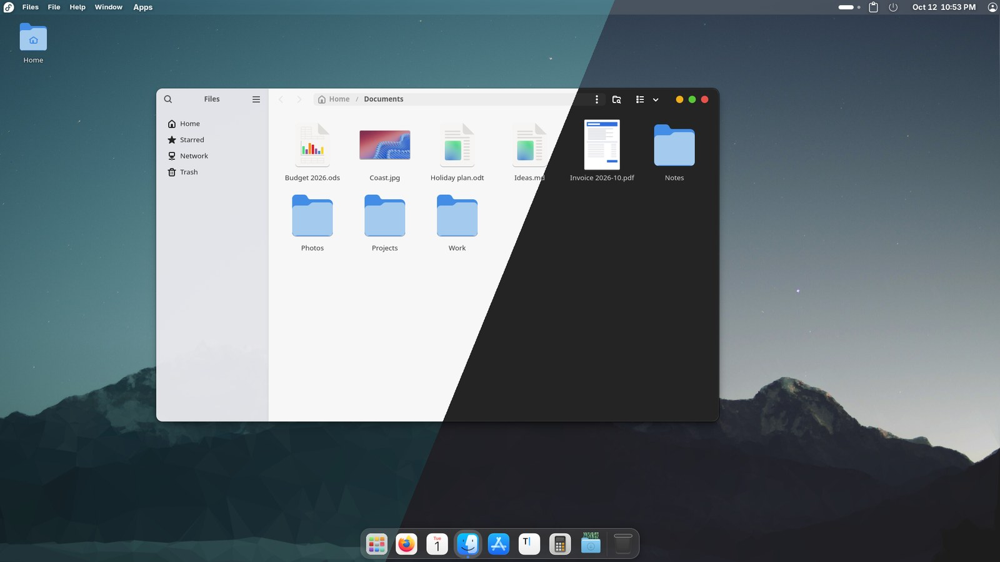
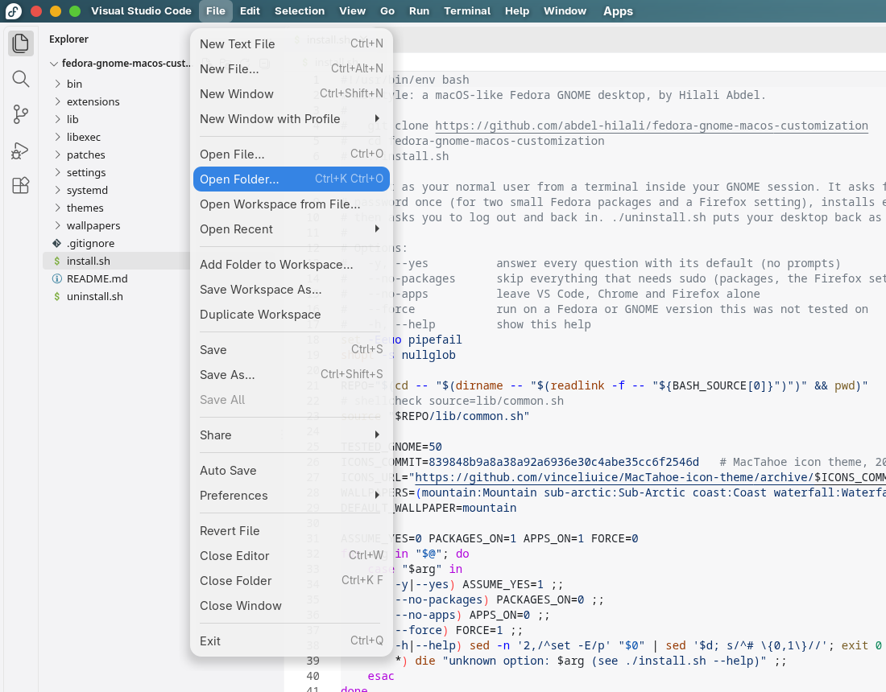
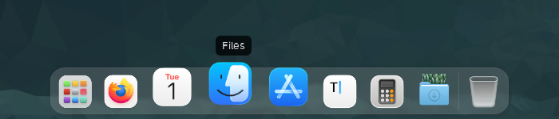
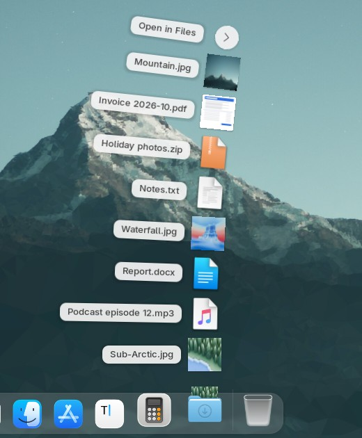
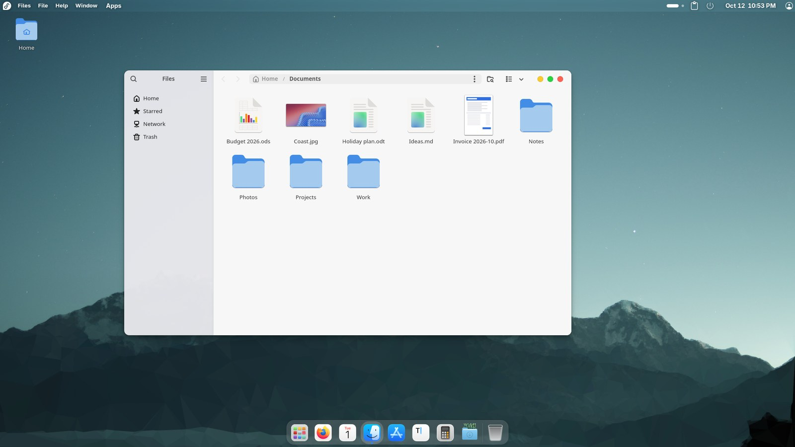
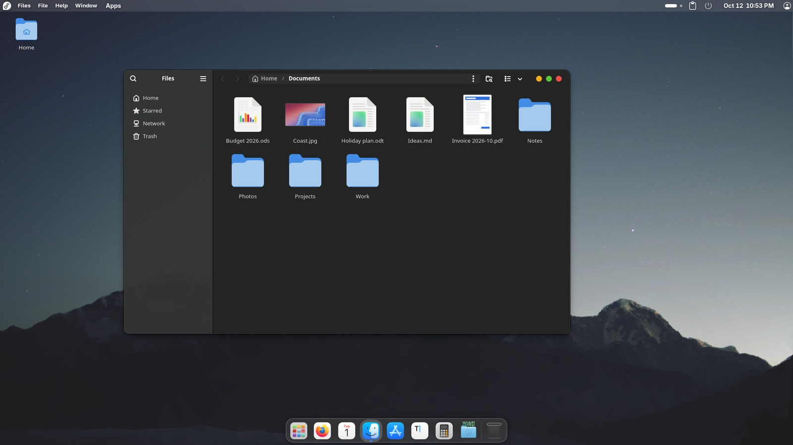

# macstyle

**A macOS-like desktop for Fedora GNOME, in one command.**

Created by **Hilali Abdel**.



macstyle gives Fedora's GNOME desktop the macOS features that make daily work easier: a dock, the app's menus in the top bar, and the window buttons in the top bar when a window is maximized. The look is its own: a soft light theme, and a Dark Style that switches everything at once.

## Install

Open a terminal and run:

```bash
git clone https://github.com/abdel-hilali/fedora-gnome-macos-customization
cd fedora-gnome-macos-customization
./install.sh
```

- Type it without `sudo`. It asks for your password itself, once, to install a few small Fedora packages and to set a Firefox default.
- It takes about a minute. It downloads the MacTahoe icon theme (about 10 MB).
- When it is done, **log out and log back in**. GNOME starts new extensions only at login.

You need **Fedora 44 Workstation with GNOME 50**, the version macstyle is tested on. Run the script from a terminal inside your GNOME desktop. If `git` is missing: `sudo dnf install git`.

To undo everything, run `./uninstall.sh` (see [Uninstall](#uninstall)).

## What you get

### Menus and window buttons in the top bar



- The top bar shows the menus of the app you are using (File, Edit, View and the rest). This works for VS Code, Chrome, Firefox, LibreOffice and other apps that publish their menus.
- Maximize a window and its close, minimize and maximize buttons move into the top bar, so the window gets the whole screen.
- Window buttons sit on the left, as on a Mac.
- Apps you install later follow too. A small background service sets up every Chromium or Electron app (Chrome, Brave, VS Code, Discord and others) when it is installed or updated.

### A dock that magnifies



Icons grow gently under the pointer (1.3×), on a translucent dock that steps aside when a window needs the space.

### Downloads fan



Click **Downloads** in the dock and your newest files fan out, with thumbnails. Click a file to open it. The dock icon shows your newest download sticking out of the folder. Right-click it for *Open Downloads Folder*, *Open Most Recent Download* and *Show Most Recent in Files*.

Downloads Fan is a GNOME extension made for macstyle.

### Dark Style switches everything

| Light | Dark |
|---|---|
|  |  |

Turn on **Dark Style** in Quick Settings and everything follows at once: apps, top bar, dock, icons, window shadows and the wallpaper (each wallpaper has a day and a night picture). The light theme is a softer WhiteSur Light, gentler on the eyes than pure white.

### And also

- A blurred, translucent top bar and dock.
- Rounded corners on every window, older X11 apps included.
- With two monitors, the second top bar matches the main one and shows the same menus.
- Six day-and-night wallpaper pairs from KDE, in Settings › Appearance. "Mountain" is set.
- An Apps menu in the top bar, Alt+Tab as a cover flow, a "magic lamp" minimize effect, desktop icons, a clipboard history in the top bar, Caffeine to keep the screen awake, and the option of a video on the lock screen.

## What the install changes

Everything goes into your home folder, except the packages and one Firefox setting.

- **GNOME extensions:** 17 extensions are copied to `~/.local/share/gnome-shell/extensions`, with their settings, and switched on. Two more come from Fedora packages (Apps Menu and Background Logo). Other docks (Dash to Dock, Ubuntu Dock, Dash2Dock Lite) are switched off.
- **Themes:** WhiteSur Light and WhiteSur Dark, plus a generated `WhiteSur-Light-soft`, in `~/.themes`. MacTahoe icons and cursor go in `~/.local/share/icons`. The file `~/.config/gtk-4.0/gtk.css` makes GTK 4 apps follow light and dark.
- **Wallpapers:** in `~/.local/share/backgrounds/macstyle`.
- **Two small background services** (systemd user units). `macstyle-darkswitch` follows Dark Style. `macstyle-appfollow` sets up Chromium and Electron apps when they are installed.
- **Apps:** Chromium browsers and Electron apps run as X11 apps with GNOME's title bar, through launcher copies in `~/.local/share/applications`, so their menus can reach the top bar. VS Code gets the native title bar and colours that match it. Firefox also runs as an X11 app, with its global menu switched on. That is a default in `/etc/firefox/policies/policies.json`, which you can still change in `about:config`.
- **Packages** (dnf): `libdbusmenu`, `libdbusmenu-gtk3`, `gnome-shell-extension-apps-menu`, `gnome-shell-extension-background-logo`.
- **Settings:** window buttons on the left; themes, icons, cursor and wallpaper; workspaces on all monitors; the Downloads icon in the dock.

Before changing anything, the first run saves your settings and every file it replaces in `~/.local/state/macstyle/original/`. Running `./install.sh` again is safe: it keeps that first copy.

### Options

| Option | What it does |
|---|---|
| `-y`, `--yes` | Answer every question with its default (no prompts). |
| `--no-packages` | Skip everything that needs `sudo`: the packages and the Firefox setting. |
| `--no-apps` | Leave VS Code, Chrome and Firefox alone. |
| `--force` | Run on a Fedora or GNOME version macstyle is not tested on. |
| `-h`, `--help` | Show the help. |

## Uninstall

```bash
cd fedora-gnome-macos-customization
./uninstall.sh
```

It brings back the settings and files saved by the first install, removes what the install added, and stops the two services. It asks for your password if it has to remove the Firefox setting. Then log out and log back in. The Fedora packages stay installed; they are harmless.

## Good to know

- macstyle is tested on Fedora 44 with GNOME 50 only. On other versions the script stops with a message; `--force` tries anyway.
- Extensions start only after you log out and back in. An app that is open during the install changes the next time you start it.
- Some apps run in X11 mode (through XWayland) so that their menus can reach the top bar. With X11 apps open, logging out takes about 5 seconds longer. This is a GNOME bug.
- AppMenu, Multi Monitors Bar, Rounded Window Corners Reborn and Dash2Dock Motion are copies with our own fixes. extensions.gnome.org does not update them. To get our updates, run `git pull` and then `./install.sh` again.
- Top-bar menus for Flatpak apps and Qt apps are not tested yet.
- The SF Pro font is not included because of Apple's licence. If you have it installed already, macstyle uses it.

## Credits and licence

macstyle is built on the work of many people: the authors of the GNOME extensions, the WhiteSur GTK theme and the MacTahoe icon theme by vinceliuice, and the KDE wallpaper artists. [CREDITS.md](CREDITS.md) lists each one, its licence and what we changed.

macstyle's own code is under the [GNU General Public License 3.0](LICENSE). The bundled parts keep their own licences.

Created by **Hilali Abdel**.
